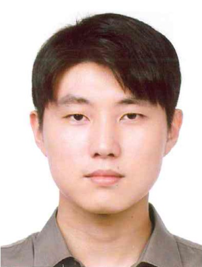
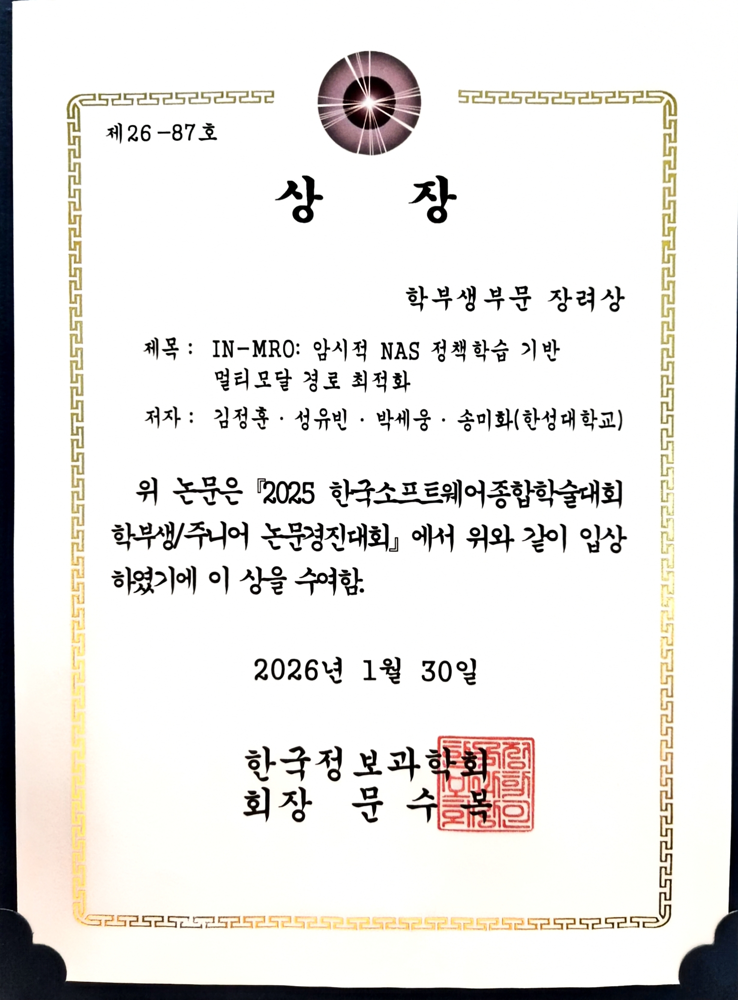
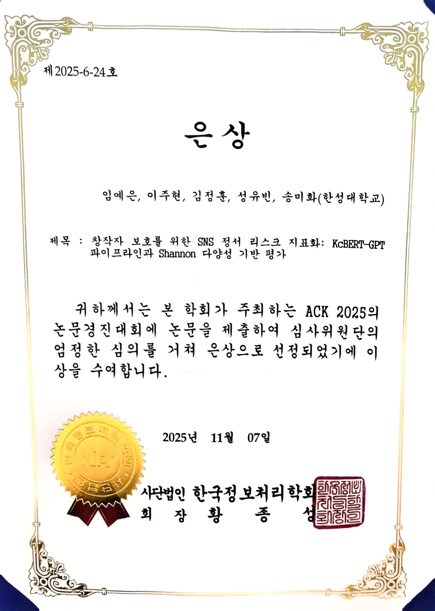
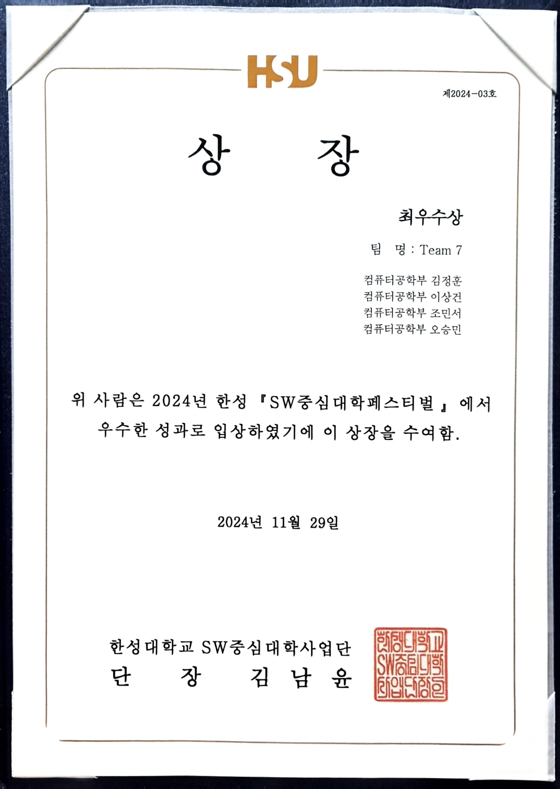
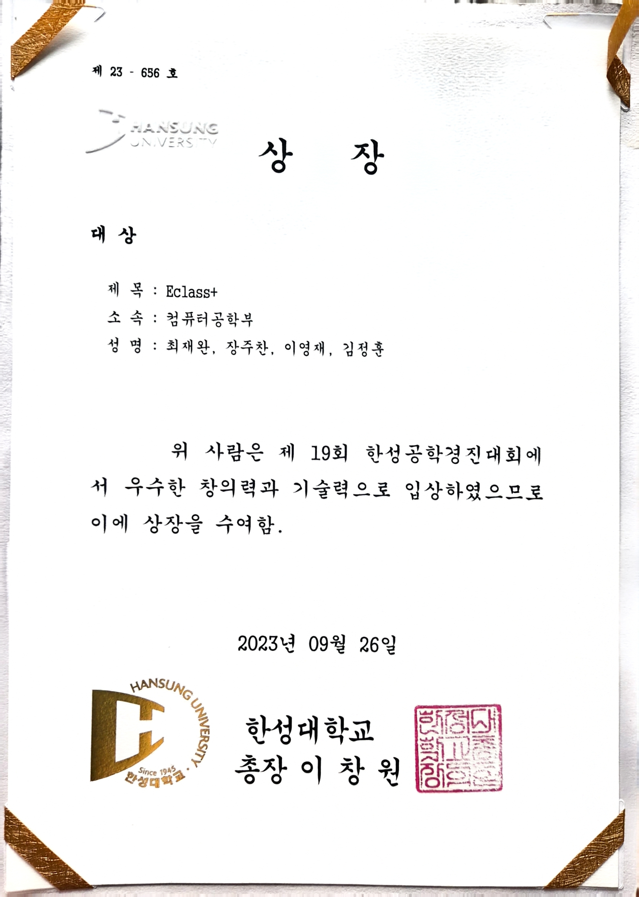
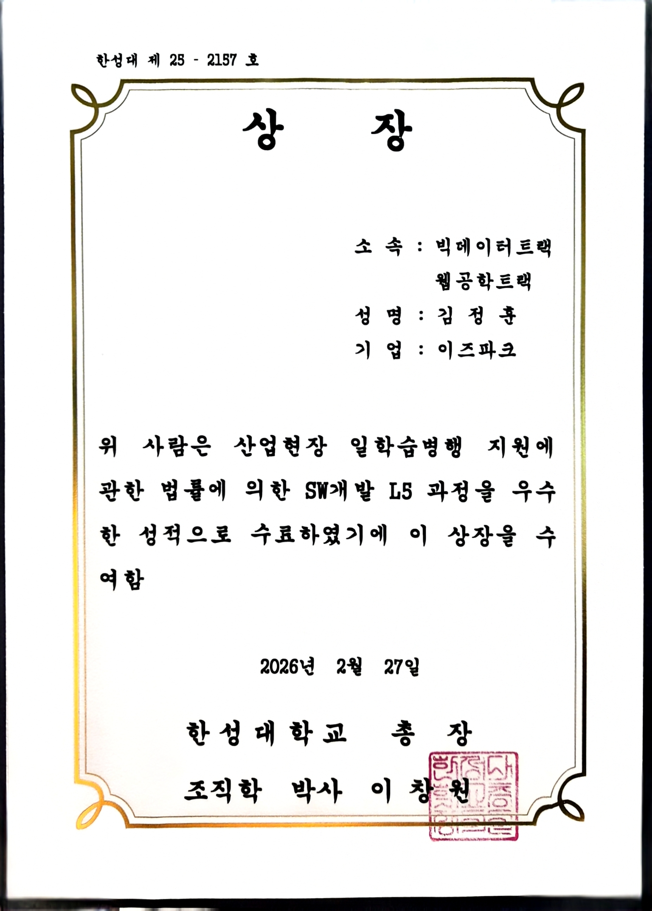

# 김정훈 · Jeonghun Kim

**AI Researcher · ㈜이즈파크 R&D Center**

멀티모달 모델 연구와 LLM/VLM 학습, AI 기능 구현 및 GPU 서빙을 하고 있습니다.

[Portfolio](https://portfolio.jhkim3ispark.work) · [TieMing Demo](https://tieming.jhkim3ispark.work)

 

<table>
  <tr align="center">
    <td><strong>5편</strong> 논문 · 제1저자 4편</td>
    <td><strong>1건</strong> 특허 출원·심사청구</td>
    <td><strong>5건</strong> 논문·프로젝트 수상</td>
    <td><strong>3건</strong> 국가·기술 자격</td>
  </tr>
</table>

## Work

- **TieMing** — Writing·Web Search·OCR·Speech·멀티턴 비서 AI
- **GomOCR** — 4.77B VLM QLoRA 학습·평가·GPU 데모
- **Enterprise Text-to-SQL** — schema grounding 구현·특허 출원 및 심사청구

## Publications

- [MRO](https://doi.org/10.7236/IJIBC.2025.17.3.144) · [Code](https://github.com/thuygom/MRO) — IJIBC 2025 · 제1저자
- [IN-MRO](https://www.dbpia.co.kr/journal/articleDetail?nodeId=NODE12577766) — KSC 2025 · 제1저자 · 장려상
- [AURA](https://www.manuscriptlink.com/society/kips/conference/ask2025/file/downloadSoConfManuscript/abs/KIPS_C2025A0306F) · [Code](https://github.com/thuygom/AURA) — ASK 2025 · 제1저자
- [SCOPE-X](https://www.manuscriptlink.com/society/kips/conference/ack2025/file/downloadSoConfManuscript/abs/KIPS_C2025B0294F) — ACK 2025 · 은상
- [SCOPE](https://github.com/thuygom/SCOPE) — AICompS 2024 · 제1저자

## Awards

<table>
  <tr>
    <td align="center" width="25%"> KSC 2025 장려상</td>
    <td align="center" width="25%"> ACK 2025 은상</td>
    <td align="center" width="25%"> SW중심대학페스티벌 최우수상</td>
    <td align="center" width="25%"> 한성공학경진대회 대상</td>
  </tr>
</table>

## Certifications

<table>
  <tr>
    <td align="center" width="30%"> SW개발 L5 과정 우수 수료</td>
    <td><strong>SW개발 L5 국가자격</strong> 정보처리산업기사 리눅스마스터 2급</td>
  </tr>
</table>
