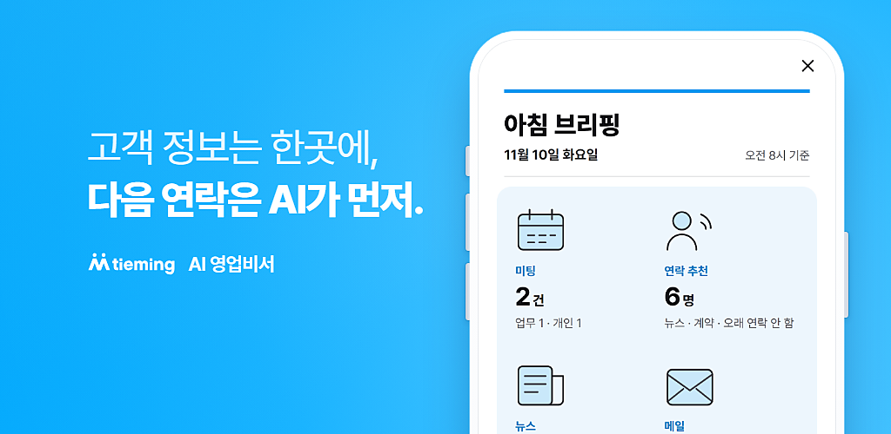
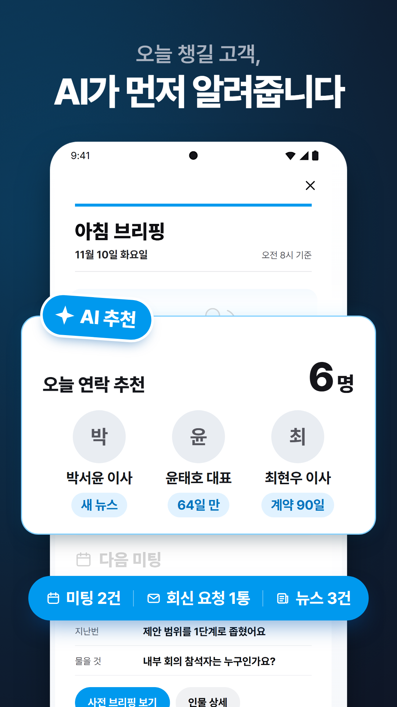
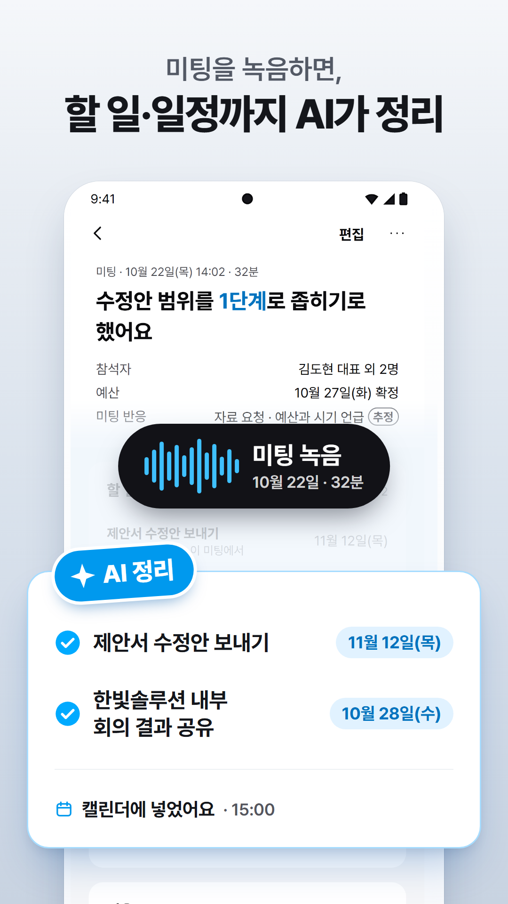
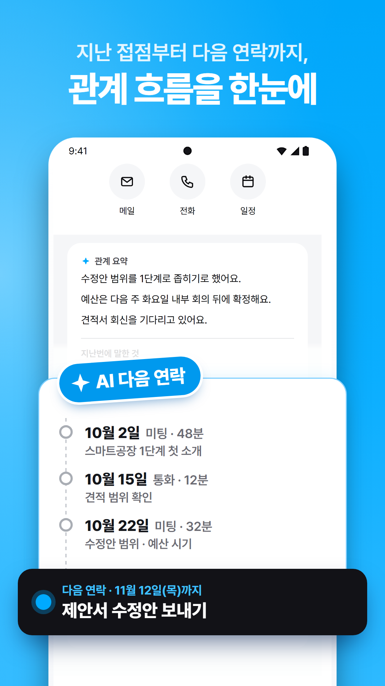

# 타이밍(TieMing)

타이밍은 지난 만남에서 나눈 이야기와 다음에 할 일을 사람·회사별로 정리해 주는 이즈파크의 AI 관계 비서입니다. 명함은 명함첩에, 약속은 통화 기록에, 미팅 내용은 메모장에 따로 남기 쉽습니다. 타이밍에서 고객을 열면 흩어진 기록과 챙겨야 할 일을 함께 확인할 수 있습니다.

타이밍 CRM은 앱과 웹에서 고객 정보가 자동으로 연동되며, 모듈 단위로 판매됩니다.

[공식 서비스 소개](https://tieming.ispark.kr/) · [타이밍 웹으로 열기](https://tieming.ai/app1/home)

## 타이밍에서 하는 일

- **고객 기록 모으기** — 명함을 찍어 연락처를 등록하고, 미팅·통화·메일의 기록을 사람과 회사별로 살펴봅니다.
- **미팅 준비와 정리** — 만나기 전에는 지난 대화와 약속을 브리핑으로 확인합니다. 미팅을 녹음하면 AI가 요약과 할 일, 다음 일정을 정리합니다.
- **다음 연락 챙기기** — 아침 브리핑에서 오늘 일정과 연락 추천을 봅니다. 고객 기록을 AI에게 물어보거나 다음 미팅 일정의 초안을 만들 수 있습니다.

## 플레이스토어 화면 시안

| 아침 브리핑과 연락 추천 | 미팅 녹음과 할 일 정리 | 관계 이력과 다음 연락 |
| --- | --- | --- |
|  |  |  |

화면은 2026년 11월 18일 수정 플레이스토어 시안입니다.

## 제가 맡은 일

이즈파크 R&D Center에서 명함 OCR, 회의 음성 인식과 화자 분리, 자연어 기반 고객 데이터 조회를 개발했습니다. 모델을 고르고 평가하는 일부터 추론 API를 구현하고 GPU에 배포하는 일까지 맡았습니다. [작업 포트폴리오](https://portfolio.jhkim3ispark.work/) · [TieMing 데모](https://portfolio-tieming.jhkim3ispark.work/)

[GitHub 프로필 README로 돌아가기](./README.md)
